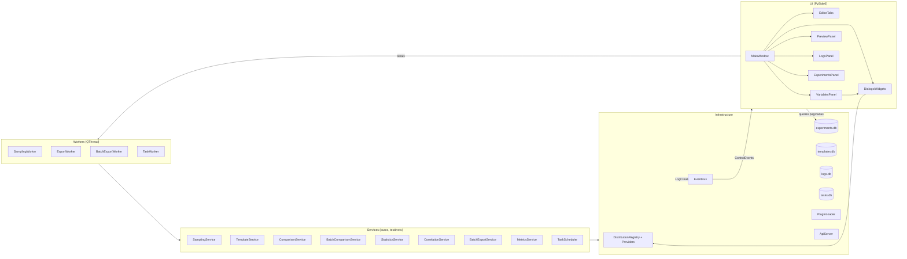

# Arquitetura — DAT Engineering Studio

Visão geral (mermaid). A UI não fala com SQL/scipy diretamente: só services e workers.

## Namespaces de variáveis

- `$1` → var_id `1`
- `$var1` / `$v1` / `$V1` → var_id `10000 + n` (`VAR_PREFIX_OFFSET`)
- Cada id é uma variável aleatória independente, com sua própria distribuição.

## Decisões relevantes

1. **Amostragem vetorizada**: uma chamada por variável (não por experimento). Suporta MC, LHS, Sobol e correlacionada (Iman-Conover).
2. **Export em lote**: paginação SQLite + tempo O(page), checkpoint por página e cancelamento cooperativo.
3. **Logs assíncronos**: fila em thread de background; leitura nunca bloqueia; `wait_pending()` drena para leituras determinísticas.
4. **Plugins**: `PluginLoader` carrega providers de `plugins/*.py`; subprocessos reconstruem o registry com `build_registry(plugins_dir)`.
